# Требования к продукту

1. Агент восстанавливает сессию и, если пора, поднимает резюме в поиске hh.ru.
2. Ищет вакансии по сохранённым запросам или в ленте сайта, отбрасывает дубликаты и уже обработанные.
3. Читает описание. Decision LLM решает, подходит ли вакансия профилю.
4. Для подходящих Generation LLM пишет письмо. Код проверяет приветствие, подпись и обязательные ссылки.
5. Агент отправляет отклик, а тесты, анкеты, капчу и недоступные формы откладывает с причиной.
6. После запуска формирует отчёт: консоль, дневной JSON, при необходимости email.

## Статусы фичей

- `INITIATIVE` — идея, работа не начата.
- `IN_PROGRESS` — функция в разработке.
- `DONE` — работает, можно пользоваться, возможны критические ошибки.
- `SUPPORT` — стабильная версия для всех пользователей.
- `DEPRECATED` — выведена из эксплуатации.

## Список фичей в разрезе статусов

| Имя                                                                   | Статус      | Какую решает проблему                                          |
|-----------------------------------------------------------------------|-------------|----------------------------------------------------------------|
| [Командная строка](cli/spec.md)                                       | DONE        | Запуск, справка и опции без чтения исходников                  |
| [Поиск и оценка вакансий](search-and-evaluating/spec.md)              | DONE        | Подборка подходящих вакансий и определение причины пропуска    |
| [Каналы поиска работы](search-channels/spec.md)                       | DONE        | Вакансии не только с hh.ru, единый цикл отклика на двух сайтах |
| [Решение о соответствии вакансии](vacancy-decision/spec.md)           | DONE        | Понятная оценка «подходит / не подходит» и причина             |
| [Автоматическое заполнение анкет](questionnaire-autofill/spec.md)     | IN_PROGRESS | Меньше ручных откликов после тестов и анкет                    |
| [Выбор резюме при отклике](resume-selection/spec.md)                  | IN_PROGRESS | Отклик только выбранным резюме, понятная ошибка                |
| [Сопроводительное письмо и отклик](cover-letter-and-response/spec.md) | DONE        | Отклик с корректным письмом или понятная причина отказа        |
| [Уведомления на email](notifications/spec.md)                         | DONE        | Уведомления о необходимости пройти капчу и отчёты              |
| [Отчётность](report/spec.md)                                          | DONE        | Итоги запуска и история вакансий без разбора логов             |
| [Веб-отчёт по вакансиям](web-ui-report/spec.md)                       | DONE        | Поиск и фильтрация вакансий, смена статусов                    |
| [Метрики поиска работы](web-ui-metrics/spec.md)                       | DONE        | Воронка, конверсии и каналы поиска                             |
| [Повторная обработка](retry/spec.md)                                  | DONE        | Повторная обработка выбранных групп вакансий                   |
| Ассистент чатов                                                       | INITIATIVE  | Автоматическая коммуникация с ИИ-ассистентами                  |
| Анализ зарплат                                                        | INITIATIVE  | Понимание рынка по должностям и периодам                       |

## Жизненный цикл приложения

Схема показывает путь от запуска до отчёта. Переходы по блокам ведут в спецификации фич, ссылки заданы в узлах
диаграммы.

```mermaid
flowchart TB
    start(["Запуск приложения"])
    cli["Командная строка и конфиг"]
    session{"Сессия и вход"}
    login["Ручной вход и капча"]
    boost["Подъём резюме, если поддерживается"]
    mode{"Основной сценарий или повторная обработка?"}
    search["Поиск вакансий"]
    filter{"Дубликат или уже обработана?"}
    precheck{"Стоп-слово или исключённая компания?"}
    open["Открытие вакансии"]
    page{"Вакансия доступна?"}
    decision["Оценка Decision"]
    fit{"Оценка выше порога?"}
    form["Открыть анкету до Generation"]
    reject{"Ответ анкеты ведёт к отказу?"}
    generation["Generation: письмо и ответы на оставшиеся вопросы"]
    ready{"Письмо и ответы готовы?"}
    auto{"Автоотправка отклика включена?"}
    apply["Выбор резюме и заполнение формы"]
    send["Отправка отклика"]
    result{"Сайт подтвердил отклик?"}
    sent["Отклик отправлен автоматически"]
    queued["Отложено, требуется ручной отклик"]
    skipped["Пропущено с причиной"]
    report[("Дневной отчёт")]
    web["Веб-отчёт"]
    metrics["Метрики"]
    notify["Email-уведомления"]
    retry_select["Выбрать вакансии для повтора"]
    finish(["Итог запуска"])

    start --> cli --> session
    session -->|"сессия есть"| boost
    session -->|"нужен вход или капча"| login
    login --> session
    boost --> mode
    mode -->|"основной"| search
    mode -->|"повторная"| retry_select
    search --> filter
    filter -->|"дубль"| skipped
    filter -->|"новая вакансия"| precheck
    retry_select -->|"нет вакансий"| report
    retry_select --> precheck
    precheck -->|"да"| skipped
    precheck -->|"нет"| open
    open --> page
    page -->|"архив, недоступна, отказ или приглашение"| skipped
    page -->|"доступна"| decision
    decision --> fit
    fit -->|"оценка не выше порога"| skipped
    fit -->|"оценка выше порога"| form
    form --> reject
    reject -->|"да"| skipped
    reject -->|"нет"| generation
    generation --> ready
    ready -->|"нет письма, ссылки или ответов"| queued
    ready -->|"всё готово"| auto
    auto -->|"нет"| queued
    auto -->|"да"| apply
    apply --> send --> result
    result -->|"отклик не подтверждён"| queued
    result -->|"сайт подтвердил"| sent
    sent --> report
    queued --> report
    skipped --> report
    report --> web
    report --> metrics
    report --> notify
    report --> finish

    classDef startEnd fill:#e8f5e9,stroke:#2e7d32,stroke-width:2px
    classDef task fill:#e3f2fd,stroke:#1565c0,stroke-width:1px
    classDef gateway fill:#fff8e1,stroke:#f9a825,stroke-width:1px
    classDef store fill:#f3e5f5,stroke:#6a1b9a,stroke-width:1px

    class start,finish startEnd
    class cli,login,boost,search,open,decision task
    class form,generation,apply,send,sent,queued,skipped,retry_select task
    class web,metrics,notify task
    class session,mode,filter,precheck,page,fit,reject,ready,auto,result gateway
    class report store

    click start "cli/spec.md" "Командная строка"
    click cli "cli/spec.md" "Командная строка"
    click session "search-channels/spec.md" "Каналы поиска работы"
    click login "search-channels/spec.md" "Каналы поиска работы"
    click boost "search-and-evaluating/spec.md" "Поиск и оценка вакансий"
    click mode "cli/spec.md" "Командная строка"
    click search "search-and-evaluating/spec.md" "Поиск и оценка вакансий"
    click filter "search-and-evaluating/spec.md" "Поиск и оценка вакансий"
    click precheck "search-and-evaluating/spec.md" "Поиск и оценка вакансий"
    click retry_select "retry/spec.md" "Повторная обработка"
    click open "search-and-evaluating/spec.md" "Поиск и оценка вакансий"
    click page "search-and-evaluating/spec.md" "Поиск и оценка вакансий"
    click decision "vacancy-decision/spec.md" "Решение о соответствии вакансии"
    click fit "vacancy-decision/spec.md" "Решение о соответствии вакансии"
    click form "questionnaire-autofill/spec.md" "Автоматическое заполнение анкет"
    click reject "questionnaire-autofill/spec.md" "Автоматическое заполнение анкет"
    click generation "cover-letter-and-response/spec.md" "Сопроводительное письмо и отклик"
    click ready "cover-letter-and-response/spec.md" "Сопроводительное письмо и отклик"
    click auto "questionnaire-autofill/spec.md" "Автоматическое заполнение анкет"
    click apply "resume-selection/spec.md" "Выбор резюме при отклике"
    click send "cover-letter-and-response/spec.md" "Сопроводительное письмо и отклик"
    click result "cover-letter-and-response/spec.md" "Сопроводительное письмо и отклик"
    click sent "cover-letter-and-response/spec.md" "Сопроводительное письмо и отклик"
    click queued "cover-letter-and-response/spec.md" "Сопроводительное письмо и отклик"
    click skipped "search-and-evaluating/spec.md" "Поиск и оценка вакансий"
    click report "report/spec.md" "Отчётность"
    click web "web-ui-report/spec.md" "Веб-отчёт по вакансиям"
    click metrics "web-ui-metrics/spec.md" "Метрики поиска работы"
    click notify "notifications/spec.md" "Уведомления на email"
    click finish "cli/spec.md" "Командная строка"
```

## Ограничения

- Капча не обходится. Массовая рассылка и работа 24/7 не поддерживаются
- Персональные данные и сессия хранятся локально. Секреты задаются в окружении
- Поддерживаемые системы: Windows, macOS, Linux. Python 3.11+
- Каналы не смешиваются: один запуск — один сайт (hh.ru, career.habr.com, etc.)

## Перспективы

- **Автоматическое прохождение тестов и анкет.** Словарь «вопрос — ответ», точные ответы, при
  отсутствии ответа — очередь и скриншот формы.
- **Новые каналы поиска.** Другие площадки кроме hh.ru и Habr Career. Каналы группируются по резюме.
- **Ассистент чатов.** Распознавание ботов и автоматическое обновление откликов.
- **Анализ зарплат.** Статистика по должностям, медиана и тренды по месяцам.
- **Удобство отчётов.** Сохранение фильтров, понятные цвета статусов, поиск, модальное окно причины,
  ссылка на лог при ошибке.
- **Управление.** `--serve`, единая справка, вынос CLI в отдельный модуль.
- **Уведомления.** Уведомление в браузере при запущенном сервере, иначе email.
- **Хранение.** SQLite/PostgreSQL и архив старых отчётов.
