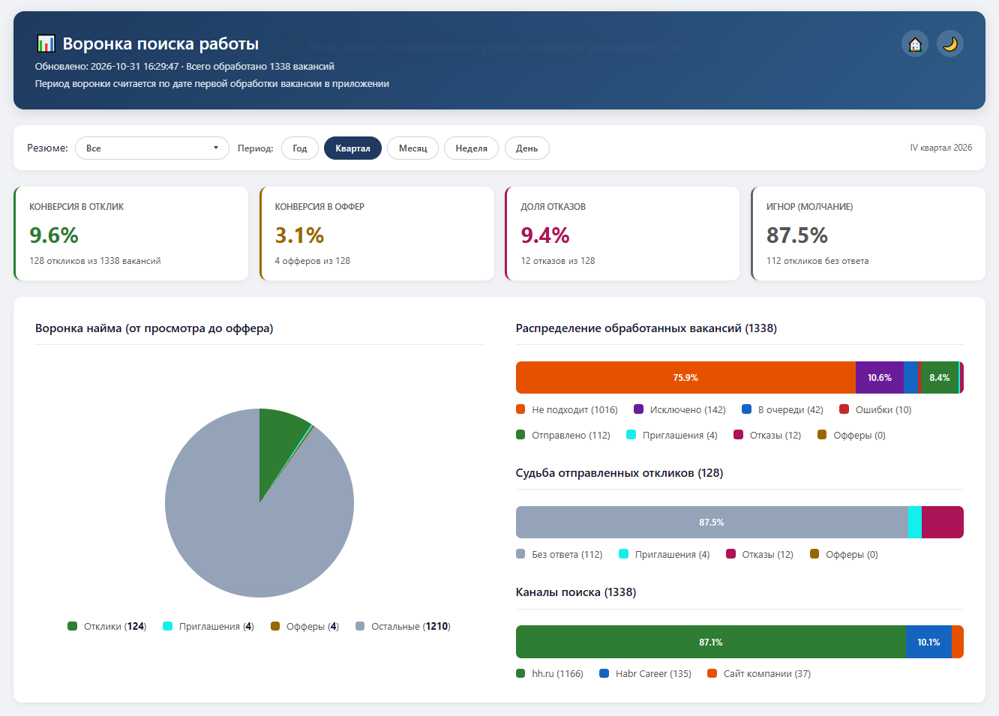

# Feature: Метрики поиска работы

## Status

`IN_PROGRESS`

> [!NOTE]
> В разработке, но работает в проде, описание неполное

## Goal

Видеть воронку и конверсии откликов без разбора логов: где проседает воронка и какие каналы приносят результат.

## Requirements

### Functional requirements

1. Страница метрик и API показывают воронку и конверсии за год, квартал, месяц, неделю или день.
2. Одна вакансия учитывается один раз — по последней записи. Период воронки считается по `created_at`. Файл, в котором
   запись лежит сейчас, роли не играет: обновление переносит её в отчёт текущей даты. Запись — это вакансия
   и профиль: у Habr профиль тоже хранится в записи, поэтому разные профили считаются отдельно. Старая копия
   без профиля относится к профилю, которым вакансию обрабатывали последний раз. Если одна из копий в архиве,
   для метрик берётся она: архив закрывает вакансию целиком
3. Метрики показывают распределение вакансий по источникам: hh.ru, Habr Career, сайт компании и записи без источника.
4. Воронка разрезается по резюме: фильтр «Резюме» показывает все записи, одно резюме или несколько. Выбор сохраняется
   при смене периода. Пункт «Все» отмечает все резюме, повторное нажатие снимает галочки, после чего можно выбрать одно
   резюме вручную. В пунктах указан источник: «hh.ru: Java Developer». У Habr профиль тоже хранится в записи, поэтому
   его пункты выглядят так же: «Habr Career: Middle Java-разработчик», а разные профили дают разные пункты. Пункт
   «<источник>: без резюме» собирает записи без профиля: отклики hh.ru, ушедшие на сайте компании (канал `external`),
   и старые копии Habr, которые ещё не обновлялись после появления профиля в записи. Такие пункты разделены по
   источнику: «без резюме: habr», «без резюме: external». Клик по пункту только отмечает его: меню остаётся открытым,
   страница не перезагружается, поэтому несколько резюме можно выбрать подряд. Список закрывается и выбор применяется,
   когда мышь уходит из меню или кнопки.
5. Вверху страницы только конверсии в процентах. Абсолютные счётчики в карточках не дублируют легенды нижних графиков.
6. В легендах графиков показываются числа, включая нули: ноль на графике — это реальный результат. Карточки конверсий
   единообразны: пока в отчётах есть вакансии, во всех четырёх стоит процент, а нулевой знаменатель даёт `0.0%`. Прочерк
   остаётся только у пустого отчёта, где считать не из чего.
7. Приглашения на графиках бирюзовые (`#11f0ec`), для текста на светлом фоне берётся тёмный вариант того же цвета. Стили
   лежат в `web/static/base.css` (общие) и `web/static/metrics.css` (страница), ссылки содержат версию файла, поэтому
   статика кэшируется браузером надолго.
8. На графике «Судьба отправленных откликов» в сегментах только проценты: названия статусов остаются в легенде под
   графиком и во всплывающей подсказке.

**Отклики** — это `sent`, `invite`, `rejected` и `offer`. Конверсия в отклик считается от всех вакансий, в приглашение и
оффер — от откликов.

**Приглашение** — переходный статус: запись может уйти дальше в `offer` или `rejected`. Графики считают приглашения по
полю `invited_at` (ставится один раз и не сбрасывается), поэтому запись, у которой статус позже откатили в `sent` или
`skipped`, всё равно видна в приглашениях. Оффер и отказ — финальные исходы, они перекрывают факт приглашения.

**Почему по дате создания.** Вакансия остаётся в когорте месяца, когда была обработана. Если отклик отправлен месяц
назад, а ответ пришёл сейчас, вакансия не переезжает в текущий месяц: меняется только её текущий статус. Это даёт
стабильную воронку по когортам.

### Limitations

- История событий не ведётся: динамику «сколько ответов пришло в выбранном периоде» и путь вакансии посчитать нельзя.
  Факт приглашения хранится только датой `invited_at`.
- Запись без `created_at` в воронку не попадает: формат отчёта требует дату обработки. Легаси-форматы не поддерживаются,
  старые отчёты приведены к текущему виду.
- Архивные записи считаются по прежнему статусу: признак `archived` метрики не исключают, поэтому архивная ошибка
  разбора попадает в «Ошибки». На странице отчёта такие записи в «Ошибках» не показываются.
- Резюме только фильтрует записи: отдельного разреза с суммами по каждому резюме нет, воронка не сравнивает резюме между
  собой.
- Пункт фильтра строится по самой записи: если дубль схлопнулся в старую копию Habr без профиля (например, архивную),
  вакансия показывается в пункте «без резюме» своего источника, хотя метрики считают её по профилю из новой копии.

## Acceptance Criteria

- [x] В метриках цифры сходятся с отчётами: повтор вакансии между файлами считается один раз
- [x] Приглашения считаются по `invited_at`: откатанный в `sent` или `skipped` статус их не скрывает
- [x] Фильтр по резюме на странице метрик: все, одно или несколько, с источником и пунктом «без резюме»
- [x] В легендах графиков числа, включая нули. Прочерк только в карточках без данных
- [x] Вверху страницы только проценты, без абсолютных счётчиков
- [x] Отклики, приглашения и офферы различаются цветом, а не близким оттенком
- [x] Приглашения бирюзовые `#11f0ec`, стили страницы метрик вынесены в общий файл стилей
- [x] Карточки конверсий без откликов показывают проценты `0.0%`, а не прочерки
- [x] Раздел `/metrics / Судьба отправленных откликов`: на графике отображаются только числа и проценты

## Related

- [web/main.py](../../../web/main.py) — `/metrics`, `/api/v1/metrics`.
- [web/metrics.py](../../../web/metrics.py), [web/templates/metrics.html](../../../web/templates/metrics.html).
- [Формат исходных данных](../report/spec.md).
