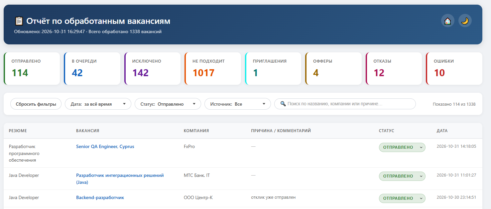

# Feature: Веб-отчёт по вакансиям

## Status

`IN_PROGRESS`

> [!NOTE]
> Работает в проде, но остаются ограничения из раздела Limitations.

## Goal

Видеть итоги откликов без разбора логов и быстро находить нужные вакансии по статусу, источнику, дате и тексту поиска.

## Requirements

### Functional requirements

1. Веб-интерфейс работает с дневными отчётами и не требует браузера hh.ru.
2. В отчёте вакансии фильтруются по статусу и по источнику, оба условия действуют одновременно.
3. Поиск идёт по названию, компании, причине и ссылке и работает вместе с фильтрами.
4. Выбранное состояние (статус, источник, даты, текст поиска) сохраняется после обновления страницы и воспроизводится
   ссылкой.
5. Кнопка «Сбросить фильтры» снимает все условия одним нажатием. Кнопка видна всегда, но неактивна, пока не выбран
   статус, источник или текст поиска.
6. Если условия ничего не нашли, интерфейс объясняет пустой результат и предлагает сброс.
7. Терминальные статусы `rejected` и `offer` нельзя сменить без подтверждения. Из `offer` нельзя перейти в другой
   статус. `invite` не терминальный: ставится из `sent`, из него можно зафиксировать`offer` или `rejected`.
8. В отчёте есть колонка «Резюме»: у hh показано название резюме, у Habr и внешней формы — прочерк. Причина показывается
   сразу после компании, затем статус и дата.
9. Чек-бокс «Выбрать всё» в фильтре «Дата» работает в обе стороны: установленный отмечает все дни, снятый снимает
   выделение со всех дней. Снятое состояние показывает пустой отчёт, подпись «даты не выбраны» и сохраняется ссылкой
   (`dates=none`).
10. Фильтры стоят одной строкой в порядке: «Сбросить фильтры», «Дата», «Статус», «Источник», поиск, счётчик «Показано N
    из N». Дата, статус и источник — выпадающие меню в стиле фильтра «Резюме» на странице метрик. Ширина меню
    фиксирована, поэтому после выбора разметка не сдвигается.
11. Карточки сводки показывают текущие статусы: «Приглашения» — сколько вакансий сейчас в этом статусе. Сколько вакансий
    вообще дошло до приглашения, видно на странице метрик (поле `invited_at`).
12. Стили и скрипты подключены ссылками с версией файла: статика кэшируется браузером надолго, а HTML перепроверяется на
    каждом запросе, поэтому обновление приложения видно сразу.

### Limitations

- Поддерживаемые системы: Windows, macOS, Linux.
- Живая проверка фильтров на реальных отчётах не выполнена: проверены разметка, стили, тесты страницы и JS-тесты
  фильтров.
- Внутри грани выбирается одно значение: несколько статусов одновременно не отобрать, мультивыбор отложен по решению из
  `design.md`.
- У значений фильтра нет счётчиков: сколько вакансий в каждом статусе и источнике, видно на странице метрик и в сводных
  карточках.
- Сохранённое состояние живёт в браузере пользователя: после очистки данных браузера остаётся только то, что попало в
  адрес страницы.
- История изменений статуса не ведётся: в отчёте видно только текущее состояние записи.

## Acceptance Criteria

- [x] В отчёте пользователь находит нужную вакансию и причину
- [x] В отчёте терминальные статусы защищены от случайного изменения
- [x] Фильтры по статусу и источнику действуют одновременно
- [x] Фильтры, включая дату и поиск, сохраняются после обновления страницы
- [x] Кнопка `Сбросить фильтры` есть всегда, но активна становится только когда выбраны все или один
  из фильтров: `Статус`, `Источник`, `Поиск`
- [x] Кнопка `Сбросить фильтры` возвращает отчёт к полному списку без фильтров
- [x] Кнопка `Сбросить фильтры` стоит первой в линии и оформлена в стиле остальных элементов панели
- [x] После ввода текста в поле `Поиск`
    - [x] Иконка `Лупа` исчезает
    - [x] Справа появляется крестик при наведении мыши на который появляется иконка `Рука`
- [x] В отчёте есть колонка «Резюме», причина стоит сразу после компании
- [x] Статус «Приглашение» ставится из «Отправлено», из него можно зафиксировать оффер или отказ
- [x] Чек-бокс «Выбрать всё» в фильтре «Дата» и выбирает все дни, и снимает выделение со всех дней
- [x] Карточка «Приглашения» показывает текущий статус и не смешивается с «дошло до приглашения» из метрик
- [x] Фильтры стоят одной строкой, ширина меню фиксирована — после выбора разметка не сдвигается
- [x] Статика кэшируется с версией файла, HTML перепроверяется на каждом запросе

## Related

- [web/main.py](../../../web/main.py) — `/report`, `/api/v1/vacancies`, `/api/v1/update-status`.
- [web/templates/report.html](../../../web/templates/report.html),
  [web/static/filters.js](../../../web/static/filters.js),
  [web/static/base.css](../../../web/static/base.css),
  [web/static/report.css](../../../web/static/report.css).
- [Дизайн фильтров отчёта](design.md).
